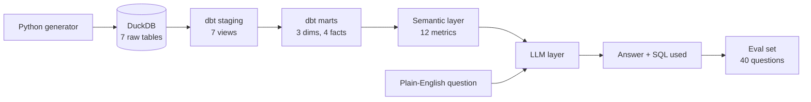

# Ironwood Fitness Analytics

An AI-enabled analytics project built from scratch on synthetic membership data for a fictional 10-location gym franchise. Raw data is modeled and tested in dbt, business metrics are defined once in a semantic layer, and an LLM answers plain-English questions using only those metrics. A 40-question eval set will measure how often the answers are right.

**Status: work in progress.** The data layer and semantic layer are done. The LLM layer is in progress, and the eval set is next.

## How it fits together



The LLM never queries tables directly. It can only choose from the defined metrics, so answers are consistent and every answer shows the SQL it ran.

## What's built

| Part | What it does | Status |
|---|---|---|
| Data generator (`generator/generate.py`) | Creates about 584,000 rows across 7 tables with a fixed seed, so every run is identical. Five patterns are planted on purpose for the LLM to find. | Done |
| Raw checks (`checks/`) | SQL that confirms the tables reconcile and the planted patterns show up as rates | Done |
| dbt staging (`ironwood/models/staging/`) | One view per raw table: dates cast to DATE, money to exact decimals | Done |
| dbt marts (`ironwood/models/marts/`) | `dim_locations`, `dim_plans`, `dim_members`, `fct_memberships`, `fct_check_ins`, `fct_payments`, `fct_member_days` | Done |
| Time spine (`ironwood/models/utilities/`) | One row per day, used by MetricFlow | Done |
| Tests | 53 dbt tests: keys, relationships, allowed values, and three custom tests (two reconciliation checks and a row-count check on the daily member table) | Done |
| Metric definitions (`docs/metrics.md`) | 11 metrics with formulas, dimensions and checks | Done |
| Semantic layer | 12 metrics across 4 semantic models in MetricFlow: churn (including churn over time), revenue and failed payments, visits per member-month, and active members, each checked against numbers verified with SQL. Still to add: new members, joins per open month, first-90-day churn and revenue per member-month. | Core done |
| LLM question-and-answer layer | Question in, metric chosen, answer and SQL out. Local model (Ollama, qwen2.5-coder 7B) | In progress |
| Eval set | 40 questions with SQL-verified answers and a scoring rubric | Planned |

## The planted patterns

| Pattern | How it shows in the data |
|---|---|
| January and September join spikes | About twice the joins of other months |
| Higher churn in the first 90 days | 10.8% a month against 4.9% after |
| One underperforming gym (Ocala) | About half the joins per open month and 1.5x the churn |
| Premium members visit more and churn less | About twice the visits per member-month of Basic, and half the churn |
| Summer dip in visits | About 20% fewer visits per member-day from June to August |

## Ask a question with the semantic layer

Metrics are defined once in YAML. MetricFlow writes the SQL.

```bash
cd ironwood
mf query --metrics monthly_churn_rate --group-by membership__plan_name
```

| Plan | Monthly churn rate |
|---|---|
| Basic | 7.9% |
| Standard | 6.5% |
| Premium | 3.7% |

Two decisions worth noting:
- **Churn over time uses daily member-months**, so each member-day counts in the period it happened. Churn fell from 8.1% to 6.0% a month between 2023 and 2025, even as total cancellations rose.
- **Active members is a count on a single day.** Grouped by year, it would count anyone who was a member at any point that year, which is a different question.

## Data quality decisions

The raw tables arrive the way a source system would export them, with a few problems fixed in staging. See `docs/data_model.md` for the full list.

- Dates arrive as midnight timestamps and are cast to DATE.
- Money arrives as floating-point numbers and is cast to DECIMAL(10,2).
- Rates use member-days, not head counts, so partial months are counted fairly. Counting "active members" made January look like a slow month when it wasn't.

## Run it yourself

Requires Python 3.12.

```bash
git clone https://github.com/easternmotionfl-web/ironwood-fitness-analytics.git
cd ironwood-fitness-analytics
python3 -m venv .venv
source .venv/bin/activate
pip install -r requirements.txt
mkdir -p data

python generator/generate.py           # build the raw data (about 10 seconds)
python scripts/run_sql.py checks/01_reconcile.sql

cd ironwood
dbt build                              # build every model and run every test
mf query --metrics revenue --group-by metric_time__year   # ask a metric question
dbt docs generate && dbt docs serve    # browse the docs and lineage graph
```

## Repo layout

```
generator/      Python data generator
checks/         SQL checks on the raw data
scripts/        Helper to run SQL files
ironwood/       dbt project (staging, marts, tests, semantic layer)
docs/           Data model, rules and metric definitions
```

## Tools

Python, NumPy, pandas, DuckDB, dbt Core, Git, MetricFlow.
